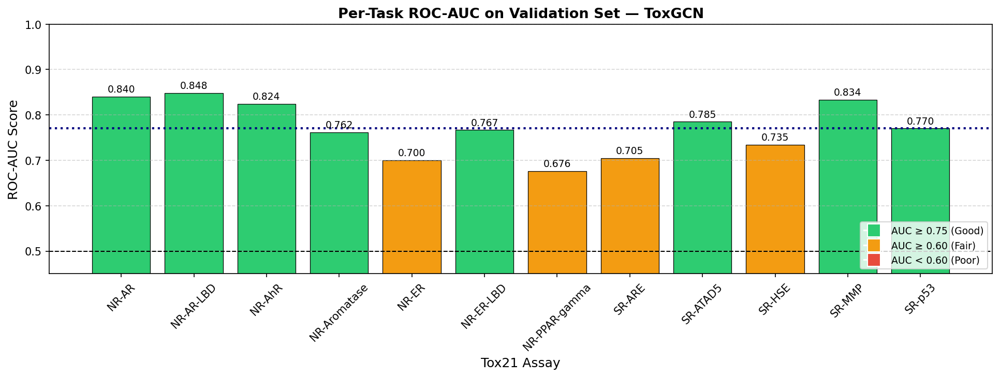
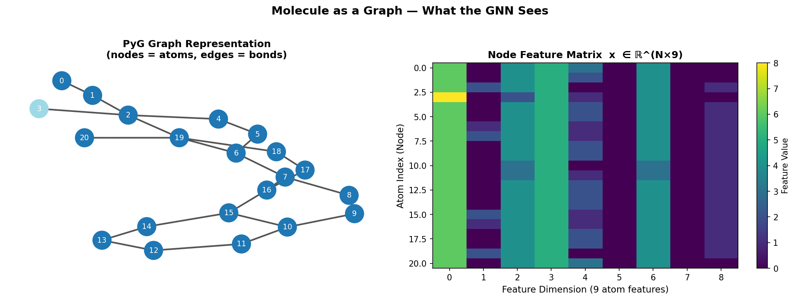
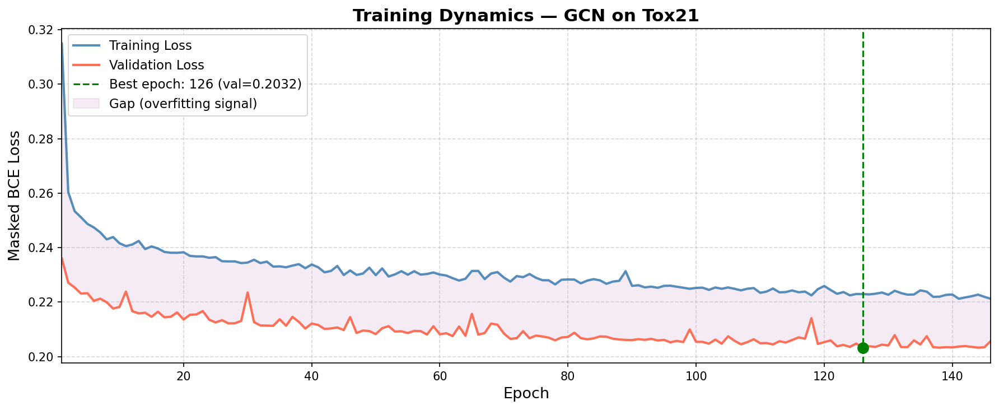

# Molecular Toxicity Prediction with Graph Neural Networks

A notebook-based machine learning project that represents molecules as graphs and predicts activity across 12 Tox21 toxicity assays using a Graph Convolutional Network (GCN).

## Highlights

- Three graph convolution layers with 128 hidden channels, global mean pooling, dropout, and a 12-output classifier.
- Masked binary cross-entropy handles missing assay labels without treating them as negative examples.
- Training uses Adam, learning-rate scheduling, checkpointing, and early stopping.
- Visual analysis includes molecular graphs, missing-label prevalence, training curves, per-assay ROC-AUC, t-SNE embeddings, and molecular profile comparisons.

## Recorded results

These values come from the saved outputs in `gnn_tox21_molecular_toxicity.ipynb`; they have not been independently reproduced for this repository preparation.

| Measure | Recorded value |
|---|---:|
| Loaded molecules | 7,823 |
| Training / validation molecules | 6,258 / 1,565 |
| Assays | 12 |
| Model parameters | 35,852 |
| Mean validation ROC-AUC | 0.7705 |
| Best validation loss | 0.2032 |
| Training epochs | 146 |

The notebook uses an 80/20 random train/validation split. There is no separate test set or scaffold split, so these are validation results, not independent test performance.



## Method

Molecules are loaded through PyTorch Geometric's MoleculeNet interface. Each graph contains nine atom features and bidirectional bond edges. The GCN aggregates neighboring atom representations, pools them into one molecular embedding, and produces 12 logits. Bond attributes are available in the dataset but are not used by this GCN.

The targets are NR-AR, NR-AR-LBD, NR-AhR, NR-Aromatase, NR-ER, NR-ER-LBD, NR-PPAR-gamma, SR-ARE, SR-ATAD5, SR-HSE, SR-MMP, and SR-p53.




## Getting started

Use Python 3.10 or 3.11 in a virtual environment. The recorded run used PyTorch 2.4.1 on CPU. The dependency list is a starting environment, not a fully locked reproduction.

```powershell
python -m venv .venv
.\.venv\Scripts\Activate.ps1
python -m pip install --upgrade pip
python -m pip install -r requirements.txt
jupyter lab
```

Open `gnn_tox21_molecular_toxicity.ipynb` from the repository root and run cells in order. The notebook downloads Tox21 through MoleculeNet into `data/Tox21`, trains the model, saves `best_tox_gcn.pt`, evaluates validation predictions, and creates plots. Internet access is required for the initial dataset download. GPU users may need a PyTorch build matching their CUDA environment.

The checkpoint contains `epoch`, `model_state_dict`, and `val_loss`. Use the `ToxGCN` architecture from the main notebook when loading it. Running the training cells overwrites the checkpoint and generated figures.

## Repository contents

| File | Purpose |
|---|---|
| `gnn_tox21_molecular_toxicity.ipynb` | Main illustrated training and analysis notebook |
| `Toxicity_Classification_GNN.ipynb` | Earlier baseline experiment with a different 64-channel architecture |
| `best_tox_gcn.pt` | Saved main-model checkpoint |
| `Enhanced_Tox21_GNN_Illustrated_Report.docx` | Illustrated project report |
| `Tox21_GNN_Project_Summary_Report.docx` | Summary report |
| `requirements.txt` | Suggested Python dependencies |
| `*.png` | Saved visualizations |

Downloaded datasets and processed caches are excluded from version control and recreated by the notebook. The baseline notebook expects its own `best_tox21_gnn.pth`, which is not supplied here.

## Limitations and next steps

- **Inference feature mismatch:** the main notebook manually builds features for new SMILES, while training uses MoleculeNet's categorical feature encoding. These encodings differ. The inference code also calls `Chem.RemoveHs(mol)` without assigning its return value, leaving explicit hydrogens in the graph. Align inference preprocessing with the training featurizer before relying on new-molecule predictions. Existing radar plots illustrate the original implementation and inherit this limitation.
- Class imbalance, a single random split, and reuse of validation data for model selection limit conclusions about generalization.
- Some notebook prose states 7,831 molecules; the saved loader output reports 7,823, which is the count used above.
- The recorded environment is not fully pinned, and the notebook has not been rerun during repository preparation. API differences may require dependency adjustments.
- Future work: scaffold-based train/validation/test evaluation, repeated seeds, class weighting, GIN/GAT models, consistent SMILES featurization, and atom-level explanations.

## Data attribution

The project uses the Tox21 dataset through PyTorch Geometric MoleculeNet. Dataset downloads remain subject to their upstream terms. See the [Tox21 program](https://tox21.gov/), [MoleculeNet paper](https://doi.org/10.1039/C7SC02664A), and [PyTorch Geometric](https://pytorch-geometric.readthedocs.io/).

## Author and licensing

Project by Shashwat Jain. No open-source license has been selected for the project code. Dataset and dependency licenses are separate.

